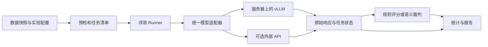

# 大模型评测框架开发需求文档

版本：V1.0｜日期：2026-10-16｜准备周期：3 天｜状态：开发规划，尚未部署或产生实测分数

适用场景：商汤科技大模型评测工程师第二次技术面试准备。本文根据个人面试项目需求设计，不代表商汤内部项目规范。

## 1. 项目目标与交付边界

在 3 天内完成一个可以真实运行、结果可追溯、能够现场讲解的基础大模型评测框架。在租用的远程 GPU 服务器上加载开源模型权重，通过统一接口完成数据读取、模型推理、答案评分、统计分析和报告导出。

推荐主线为：**单卡部署 Qwen3-8B 和 Qwen2.5-7B-Instruct，顺序评测 AA-Omniscience-Public 公开题集，并用 MMLU-Pro 小样本补充验证规则评分能力。** 两个不同模型构成横向比较；同一模型的思考模式、量化版本或不同温度只能作为配置实验。

项目必须回答四个问题：模型实际答得怎样；结果依据是什么；如何复现；在什么条件下结果可比。模型得分高低不作为验收条件。

| 优先级 | 本期范围 | 完成标准 |
|---|---|---|
| P0，3 天必做 | 两个真实模型、两种评分方式、服务器部署、可靠执行、可追溯结果 | 按第 12 节验收，有完整原始证据 |
| P1，有余量再做 | 一个外部 API 被测模型、简单 HTML/Streamlit 展示、更多数据、思考模式或量化对照 | 独立实验配置，不影响 P0 交付 |
| 后续 | AA-LCR 长上下文、代码执行评测、Agent 评测、多机调度、完整权限系统 | 单独设计与排期 |

本期不包含训练或微调，不建设生产级评测平台，也不承诺复现 Artificial Analysis 综合榜单。模型服务部署在远程服务器，评测进程优先在同一服务器执行；开发电脑通过 SSH 管理和下载结果。

## 2. Artificial Analysis 的使用口径

Artificial Analysis（下称 AA）是评测平台，涉及榜单结果、评测方法及多个基准。**获取 AA 的榜单/API 结果，不等于获取评测题目，也不构成本项目的真实推理实验。**

截至本文核查，官方 Intelligence Index 方法页标记为 v4.3.2，包含 10 项评测；部分内容受限。MMLU-Pro 已从该综合指数移除，因此本文仅将其用作补充规则任务。后续实现须保存方法页的访问日期和快照，不把历史版本的方法与当前榜单混用。[AA 官方评测方法](https://artificialanalysis.ai/methodology/intelligence-benchmarking)

本项目直接采用 AA 官方发布的 **AA-Omniscience-Public**：公开集 600 题，是完整 6,000 题的 10%，许可标记为 Apache-2.0。官方提示，公开集的领域/主题样本不足以支持可靠的细分排名。因此，主报告呈现总体指标，领域结果只用于探索和错误分析。[AA 官方公开数据集](https://huggingface.co/datasets/ArtificialAnalysis/AA-Omniscience-Public)

报告必须使用以下名称：

- 默认：`AA-Omniscience-Public / 600题 / 本项目推理与评分配置`。
- 更换官方指定裁判：加注 `替代裁判`。
- 缩小样本：加注 `公开集抽样 n=实际题数`。
- 仅人工评分：加注 `人工评分探索实验`。
- 禁止将上述结果命名为 `AA官方得分`、`完整AA榜单复现` 或 `Artificial Analysis Intelligence Index`。

即使采用相同评分公式，公开题目、模型版本、裁判、输出预算和执行环境的差异仍会影响可比性。若展示官网结果，仅列为带日期、版本和来源的外部参考，不与本项目结果混合排序。

## 3. 评测对象与实验规模

### 3.1 模型

| 角色 | 默认选择 | 配置要求 | 选择目的 |
|---|---|---|---|
| 主模型 | `Qwen/Qwen3-8B` | BF16；显式关闭 thinking；固定权重和 tokenizer revision | 完成 8B 模型服务器部署及真实评测 |
| 对照模型 | `Qwen/Qwen2.5-7B-Instruct` | BF16；固定权重和 tokenizer revision | 在同一硬件上完成不同模型的横向比较 |
| 可选模型 | 可获取稳定版本的商业 API 或另一开源模型 | 记录提供商、实际模型 ID、日期及参数 | 验证远程 API 适配能力 |

两个默认模型都有官方权重及模型卡；选择它们是为了降低三天项目的接入成本，不代表它们是当前最强或最新模型。[Qwen3-8B](https://huggingface.co/Qwen/Qwen3-8B)、[Qwen2.5-7B-Instruct](https://huggingface.co/Qwen/Qwen2.5-7B-Instruct)

两模型使用相同任务文本和评测协议，但保留各自官方 chat template。P0 定义项目自己的受控基线：非思考、`temperature=0`、`top_p=1`，关闭额外采样过滤，固定 seed（后端支持时）。这是一项便于比较和排错的实验约定，不声称符合各模型的最佳性能设置。Qwen3 官方对思考与非思考模式给出了不同采样建议；思考模式不纳入此基线。[Qwen3 模型使用建议](https://huggingface.co/Qwen/Qwen3-8B)

输出预算初值：AA 短问答 512 tokens，MMLU-Pro 1,024 tokens。开发阶段先检查截断比例；正式运行前冻结预算。发现明显预算不足时，应修订配置并为两模型建立新实验，不能只给落后模型追加生成机会。

### 3.2 数据及数量

| 数据 | P0 数量/模型 | 用途 | 评分方式 |
|---|---:|---|---|
| AA-Omniscience-Public | 全部 600 题 | 跨领域知识、错误回答与弃答行为 | 冻结的语义裁判协议 |
| MMLU-Pro | test split 中固定随机 200 题 | 选择题推理；验证确定性评分路径 | 最终选项提取与精确匹配 |
| 自建小型契约用例 | 约 10–20 条，不计能力分数 | 错误注入、解析边界、重试和恢复 | 明确的预期状态 |

正式主实验共 **1,600 次被测模型生成**，另有约 **1,200 次 AA 裁判调用**；冒烟测试、复核、重试和性能测试另计。该数量是工作量规划，不是已经执行的记录。

MMLU-Pro 来自 TIGER-Lab 官方数据仓库，包含选择题、答案、类别等字段，数据卡标记 MIT。从 test split 按固定 seed 无放回均匀抽样，保存样本 ID；不依据模型作答情况挑题。validation split 可用于开发，test 中的答案及 `cot_content` 不得进入被测模型请求。[MMLU-Pro 官方数据](https://huggingface.co/datasets/TIGER-Lab/MMLU-Pro)

AA 数据平台上的 split 名称即使为 `train`，本项目仍将其视为评测数据，不据此训练模型。正式报告不得把公开 600 题称为完整 6,000 题。

## 4. 8B 服务器租用建议

### 4.1 推荐配置

**优先选择单张 RTX 4090 24GB、16 vCPU、64GB 内存、150GB 可用 SSD、可 SSH 访问的 Linux GPU 实例。** 先租 1–2 小时验证模型下载、驱动兼容、加载和最长请求，再决定后续租期。若平台配额略有差异，CPU 至少 8 vCPU；内存 32GB 可尝试，但推荐 64GB 留出加载和缓存空间。

| 档位 | GPU | CPU / 内存 / 磁盘建议 | 适用条件 |
|---|---|---|---|
| 首选 | 1 × RTX 4090，24GB | 16 vCPU / 64GB / 150GB SSD | 8B BF16、短上下文、低并发；两模型顺序加载 |
| 预算备选 | 1 × RTX 3090 或 A10，24GB | 8–16 vCPU / 64GB / 150GB SSD | 报价明显更低且兼容性验证通过；速度必须实测 |
| 显存宽裕 | 1 × L20 或 A40，48GB | 16 vCPU / 64–128GB / 150–200GB SSD | 需要更长输入或更高并发，或 24GB 调试占用过多时间 |

4090 的 24GB 规格可见租用商产品页；A40 和 L20 的 48GB 规格可见 NVIDIA 文档。以上搭配属于本项目的工程建议，不能据此保证特定吞吐或上下文容量。[Runpod 4090](https://www.runpod.io/gpu-models/rtx-4090)、[NVIDIA A40](https://www.nvidia.com/en-us/data-center/a40/)、[NVIDIA L20 配置](https://docs.nvidia.com/ai-enterprise/release-8/latest/infra-software/vgpu/reference/ada-lovelace.html)

暂不租多卡服务器。两模型无需同时驻留显存，也无需为本期任务直接选择 A100/H100。如果两档价格接近且预算允许，48GB 可减少显存调试，但不保证推理一定更快。

### 4.2 显存估算与起始配置

8B 参数模型的 BF16 权重粗略占用为 `8×10^9×2 bytes ≈ 16GB ≈ 14.9GiB`。实际还需要 KV cache、激活、CUDA graph、框架缓存等，因此“权重能放下”不能直接等同于“服务能稳定运行”。

以 Qwen3-8B 的结构为例，按 36 层、8 个 KV heads、head dimension 128、BF16 KV cache 计算，单序列 8,192 tokens 的 KV 数据理论量约 1.125GiB；这是估算，未包含内存分配与运行时开销。[模型结构配置](https://huggingface.co/Qwen/Qwen3-8B/blob/main/config.json)

24GB 实例的服务起始参数建议：

| 参数 | 初值 | 要求 |
|---|---|---|
| dtype | BF16 | 不静默更换为量化模型 |
| 最大总序列长度 | 8,192 | 输入、模板和输出预算之和受此限制；以实测为准 |
| 最大并发序列 | 1 | 稳定后再独立测试 2/4；主实验配置冻结 |
| GPU 显存使用比例 | 0.85–0.90 | 明确记录实际设置，不依赖版本默认值 |
| tensor parallel | 1 | 单卡部署 |
| 量化 | 无 | 若另做量化，建立独立实验 |

预检必须用两个模型各自的 tokenizer 检查全体样本的输入长度。若超限，调整统一预算或升级资源；不静默截断题目，不只删除长题。显存不足时优先降低并发、检查其他 GPU 进程和 CUDA graph 配置；必要时升级 48GB。vLLM 提供上下文、batch 和图执行相关的内存控制能力。[vLLM 内存管理](https://docs.vllm.ai/en/latest/configuration/conserving_memory/)

### 4.3 平台与费用

可优先在 AutoDL 查询有现货的 24GB 单卡实例和合适镜像，其创建流程支持按地区、GPU 和镜像选择；具体单价必须以租用页面为准。本次没有取得可保证成交的 AutoDL GPU 实时报价。[AutoDL 创建实例](https://www.autodl.com/docs/quick_start/)

Runpod 可作为备选参考：核查时 4090 页面分别显示 Community Cloud **US$0.34/小时起**、Secure Cloud **US$0.89/小时起**。对应 24 小时算术值分别为 US$8.16、US$21.36；72 小时为 US$24.48、US$64.08。它们是起价计算，未包含存储、裁判 API、税费等，也不保证库存或最终订单价格。[Runpod 4090 报价页](https://www.runpod.io/gpu-models/rtx-4090)

预算按下式管理，不把“准备期 3 天”机械等同于持续开机 72 小时：

`总费用 = GPU实例小时单价 × 实际开机小时 + 存储/网络 + 裁判API + 可选被测API`

可先按 20–30 个 GPU 开机小时编制预算，之后用冒烟测试的真实吞吐和下载耗时修订。若需要人民币总额占位，可暂设 **300–500 元的项目预算草案**，这属于开销控制建议，不是市场报价或已批准支出。租用前必须填写实际 GPU 单价、总上限、裁判额度。

裁判成本应根据前 20 个校验请求的真实输入、输出及计费推理 tokens 外推，加入重试余量。GPU 费用与 API 费用分开记录，达到额度 80% 提醒、接近上限时预留在途请求费用并停止新任务，保存已有结果。GPU 实例需在平台端关机才能停止相应计算计费，仅停止评测脚本不够。AutoDL 的 GPU 计算与存储计费规则不同，关机后仍需检查存储费用；面试前也应确认停机后再次开机的资源可用性。[AutoDL 计费说明](https://www.autodl.com/docs/price/)

## 5. 系统结构与技术选型

P0 采用 Python 命令行项目。推理使用 vLLM 提供的 OpenAI-compatible HTTP 接口；数据可用 Hugging Face Datasets 或 CSV 加载；配置使用 YAML 与字段校验；任务状态采用 SQLite，结果导出 JSONL、CSV、Markdown。固定依赖版本和容器镜像 digest，避免开发期间自动漂移。

vLLM 官方提供服务命令和容器镜像，适合把模型部署与评测逻辑分离。本项目先接入其现有 API，不额外开发一套推理 HTTP 服务。[vLLM CLI](https://docs.vllm.ai/en/latest/cli/)、[vLLM Docker](https://docs.vllm.ai/en/latest/deployment/docker/)

| 模块 | 职责 | 边界 |
|---|---|---|
| DatasetAdapter | 读取、校验、抽样、产生稳定样本 ID | 不调用模型 |
| PromptBuilder | 根据任务生成请求 | 被测输入不含答案或评分信息 |
| ModelAdapter | 请求格式适配、参数验证、响应标准化 | 不判断答案正确与否 |
| Runner | 并发、限流、超时、重试、断点恢复 | 只对执行失败按策略重试 |
| Scorer | 规则评分或调用独立裁判 | 不反向修改原始回答 |
| Store | 保存任务状态、请求、响应及评分版本 | 原始结果可导出，历史不覆盖 |
| Reporter | 汇总、区间估计、错误样例、成本 | 能离线重建报告 |

以薄层适配为原则复用成熟库，避免三天内引入分布式队列、Kubernetes 或多个评测框架的深度整合。

## 6. 功能需求

| 编号 | 优先级 | 需求 | 验收依据 |
|---|---|---|---|
| F01 | P0 | 配置驱动，支持数据、模型、采样、预算、路径 | 无需改业务代码即可切换两个默认模型 |
| F02 | P0 | 固定数据版本与样本清单 | 保存 revision、文件 SHA-256、条数、ID；两模型清单一致 |
| F03 | P0 | 启动前预检 | 校验端点、模型身份、上下文、参数、评分依赖和剩余预算 |
| F04 | P0 | 批量真实推理 | 请求与原始响应逐条保存；正式运行禁用 mock |
| F05 | P0 | 有限重试与恢复 | 注入超时、429/5xx、连接失败后可恢复且不重复计分 |
| F06 | P0 | 两类评分器 | AA 四分类裁判与 MMLU-Pro 选项评分均可独立执行 |
| F07 | P0 | 响应缓存与重新评分 | 修改评分版本只重算评分，不重新调用被测模型 |
| F08 | P0 | 统计与质量报告 | 显示样本量、完成情况、分数、区间、错误及局限 |
| F09 | P0 | 成本和时长记录 | 本地租赁、被测 API、裁判 API 分账；估算与账单区分 |
| F10 | P0 | 基础性能测量 | 固定负载下采集延迟、成功率、输出长度及吞吐 |
| F11 | P1 | 接入额外 API | 能识别不支持的参数，记录版本无法完全冻结的限制 |
| F12 | P1 | 可视化页面 | 基于保存的结果展示，不依赖重新推理 |

命令行应提供 `prepare`、`preflight`、`run`、`resume`、`score`、`report`、`bench` 七类操作。它们是拟开发接口名称，当前尚未实现。

## 7. 评分协议

### 7.1 AA-Omniscience-Public

使用官方数据卡的回答模板与裁判模板，并保存来源 revision 和模板 hash。被测模型不联网、不调用工具、不进行 RAG，参考答案只进入评分阶段。四类裁判输出为 `CORRECT`、`INCORRECT`、`PARTIAL_ANSWER`、`NOT_ATTEMPTED`；不得用简单字符串包含替代语义判定后仍宣称遵循官方评分。[官方模板与评分分类](https://huggingface.co/datasets/ArtificialAnalysis/AA-Omniscience-Public)

需要特别锁定**方法版本**：数据卡保留的最初裁判说明与当前方法页不同。本文核查时，当前方法页指定 GPT-5.6 Luna（medium）；不能把数据卡历史裁判描述当成当前配置，也不能将桌面应用里可用的模型名称直接当成可调用 API ID。[当前方法及变更记录](https://artificialanalysis.ai/methodology/intelligence-benchmarking)

实现时按以下顺序选择，并在第 1 天前两小时内确定路线：

| 路线 | 条件 | 结果标签 |
|---|---|---|
| A，优先 | 官方当前指定裁判确实可通过用户账号调用，且预算可承受 | 公开集、指定裁判、列出其余协议差异；不称完整榜单复现 |
| B，可交付 | 使用另一款已验证且可访问的较强裁判；同一裁判评估两个模型 | 公开集、替代裁判；明确存在裁判偏差 |
| C，应急 | 没有可用裁判 API | 运行预先冻结的公开集 120 题并人工评分；标记缩减交付，P0 全量自动评分未完成 |

禁止使用被测 8B 模型为自己评分并作为最终可信结论。裁判输入不包含被测模型名字；原始裁判响应、最终标签、实际 API 模型 ID、参数、时间和用量必须保存。非法标签、空响应或超时属于 `scorer_error`，不得自动转为模型答错或弃答。

评分聚合应逐项实现发布论文中的定义，输出正确率、幻觉率、弃答相关统计及 Omniscience Index；`PARTIAL_ANSWER` 的权重与分母必须按选定版本处理。公式及边界处理写入评分版本说明，禁止凭直觉把幻觉率设为“错误数/已作答数”。精确定义见附录 A。

人工质量审核：从两个模型的 AA 结果中各随机抽 30 条，盲化模型名检查分类；另检查全部裁判异常及明显矛盾样例。报告随机抽查的一致率和分歧清单。发现系统性错误，修正评分实现或更换裁判后对两个模型完整重评，保留前后版本。上游模板疑点不得静默改写；如需改动，建立项目自定义版本并说明差异。

### 7.2 MMLU-Pro

P0 使用项目自定义的 zero-shot 选择题协议：提供问题及原始选项顺序，要求回答最后一行采用 `ANSWER: X`，允许此前有简短分析。明确声明该协议不等同于其他榜单的 few-shot 或 CoT 设置。

提取器仅接受一个有效最终选项，不能扫描长回答中任意出现的正确字母。多选项冲突、没有最终答案、格式错误统一按事先定义的规则记 0，并单列格式错误率；参考答案取官方字段，不传给被测模型。

准确率为 `答对题数 / 计划题数`，前提是计划题的推理与评分均完成。只完成部分任务时先展示完成率和部分结果，不发布完整实验准确率。预定义样例需覆盖正确、错误、大小写、空回答、无效选项、多选项冲突及被截断输出。

## 8. 真实、可靠、可复现要求

### 8.1 实验固定与数据防泄漏

每个正式运行生成不可变 `run_manifest`，至少包含：代码 commit、环境版本、GPU/驱动、模型与 tokenizer revision、权重精度、chat template、数据 revision/hash、样本 ID、prompt hash、生成参数、上下文和输出预算、裁判与评分版本、开始时间。

开发测试与正式运行分开。冒烟结果不得挑选后混入正式表；正式结果不能因为分数不理想而换题、改 prompt 后覆盖旧记录。模型可能已接触公开题目，报告需要承认无法完全排除训练污染，不能将公开基准结果解释为无污染的能力证明。

### 8.2 错误与重试

执行状态与评分标签分开保存：

| 类型 | 例子 | 处理 |
|---|---|---|
| 暂时性执行失败 | 429、连接异常、可恢复 5xx、超时 | 最多 3 次重试，即含首次最多 4 次；退避加随机抖动，遵守 Retry-After |
| 配置或资源错误 | 鉴权失败、未知模型、上下文超限、OOM | 暂停相关任务并处理原因，避免无意义重复调用 |
| 模型正常输出 | 答错、拒答、弃答、格式不合要求 | 直接按协议评分，不为提高分数重新生成 |
| 生成达到上限 | finish_reason=length | 保存截断标记与原文，按冻结规则评分并报告比例 |
| 裁判失败 | 标签非法、裁判超时 | 按裁判重试策略处理；最终失败保持缺失，不能判成被测模型错误 |

正常完成但内容为空的模型响应与网络层未返回响应必须区分：前者按任务评分协议处理，后者为执行失败。保留每次尝试，固定采用首次成功完成的响应；网络超时后服务端可能仍已计费，恢复只能保证本地不重复计分，不能保证供应商不重复计费。

断点恢复键至少包含 `run_id + model_revision + sample_id + repeat_id`。已成功完成的生成不得再次提交；评分失败只重试评分。缓存键必须覆盖影响生成的所有配置，不能跨模型或跨 prompt 错误复用回答。

### 8.3 完整率与统计

每张分数表同时显示：计划数、成功生成数、完成评分数、各类错误数、重试数、截断数。存在未解决的执行或评分失败时，运行标记为 `INCOMPLETE`，不与完整运行直接排名。

P0 提供正确率的 95% Wilson 区间；两模型使用相同题目，差值优先使用按题配对 bootstrap，并为 Omniscience Index 等复合指标重算相应区间。不得将一份题集重复生成三遍当作三倍独立题量。

对固定公开集完成全量评测时，点估计就是该题集的结果；重采样区间仅用于描述题目组成敏感性或相应假设下的不确定性，不能覆盖裁判偏差、数据污染与对真实业务场景的外推风险。

预先固定 20 个样本，对两模型分别额外复跑一次，检查响应和评分一致性。结果不同应调查引擎、采样、裁判或版本变化；即使温度为 0，也不承诺跨硬件和服务版本逐字一致。

## 9. 数据保存与报告格式

| 记录 | 最低字段 |
|---|---|
| 样本 | dataset_id、revision、sample_id、question、options、reference、domain/topic、source |
| 生成 | run_id、model_id/revision、请求 messages、参数、完整可见响应、finish_reason、token 用量及来源、耗时、attempt、错误 |
| 评分 | response_hash、scorer_version、judge_id、裁判模板 hash、原始裁判响应、标签、数值分数、人工复核备注 |
| 运行摘要 | 计划/完成数量、错误分布、硬件、环境、成本、统计方法、报告生成时间 |

SQLite 作为单机任务状态与记录的权威存储，事务写入生成结果和最终状态。JSONL/CSV 是可导出的审阅与复算材料；报告必须可以从导出的响应和评分快照离线重建。禁止只保存汇总分数或覆盖上一轮结果。

报告交付包含：实验条件、数据覆盖、两模型总体结果、置信区间、失败与截断情况、随机复核、3–5 个有代表性的错误案例、基础性能、实际费用和结论限制。领域图表标记为探索性，不做可靠专业能力排名。

API key、SSH 私钥等不进入配置仓库、终端录屏或结果日志。被测输出在报告中按文本转义，避免内容被作为 HTML 或命令执行。

## 10. 服务器部署与性能验收

部署需提供环境检查、模型下载、启动、健康检查、停止、日志定位和结果备份的操作说明。优先使用固定版本的 vLLM 容器；租用环境不支持 Docker 时，使用独立 Python 环境并锁定已验证的包版本。记录镜像或环境快照、驱动和 CUDA 兼容性，不盲目升级驱动。

服务验收至少包括：

1. `nvidia-smi` 能确认 GPU、显存和模型进程；保存加载日志及实际权重路径。
2. 健康端点、模型列表和真实聊天请求成功；切换模型后重新核对加载日志，避免只更改模型别名。
3. 运行最长允许输入加预留输出的边界请求，完成连续请求测试且无 OOM。
4. 停止并重启服务后可以恢复；服务器上的进程不依赖开发电脑持续连接。
5. 默认通过回环地址/私网和 SSH 隧道访问；需要公网入口时添加鉴权及来源限制。
6. 原始输出、环境清单和报告定期下载至本地，确保面试可以离线展示。

性能实验与能力实验分开。P0 每模型做 5 次暖机，再执行至少 30 个固定负载请求；默认并发 1。选择不会命中能力评测缓存的性能输入，记录输入长度、输出长度、prefix cache 设置、客户端位置和服务器状态。

至少报告端到端延迟 p50/p95、成功率、实际输出 tokens 和总吞吐。只有记录流式首个非空内容事件时才报告 TTFT；排除纯 role、空 delta 和心跳。对推理模型若未来开放 reasoning 流，应另区分首个推理 token 与首个答案 token。

可报告单请求生成速度 `(输出tokens−1)/(结束时间−首token时间)`，并注明 token 来源；边界值或缺失时显示 N/A。不同 tokenizer 的 tokens/s、不同网络路径的 API 延迟不能直接等同于硬件效率。30 个请求的 p95 仅作为初步观测，不承诺稳定服务 SLO。

## 11. 三天执行计划

| 时间 | 必须完成的工作 | 当日退出条件 |
|---|---|---|
| 第 1 天，前 2 小时 | 确认实际租价和预算；验证题集下载；确定裁判路线；冻结范围 | 已知模型与数据可获取，裁判能调用或明确启动应急路线 |
| 第 1 天，其余时间 | 部署主模型；校验对照模型可加载；建立配置、数据适配、请求与存储流程；跑 10–20 题冒烟 | 两模型、两个任务和两种评分路径均能端到端完成；正式配置冻结 |
| 第 2 天 | 完成重试/断点；跑两个模型正式生成与评分；保存快照 | 默认目标：1,600 次正式生成及所需评分完成；异常有清单 |
| 第 3 天，前半天 | 完成失败修复、抽查评分、稳定性复跑和基础性能实验 | 完整性门槛通过；结论可由记录支持 |
| 第 3 天，后半天 | 生成最终报告、部署说明、复现步骤和演示材料；本地备份 | 5 分钟演示可离线完成；现场请求可选 |

第 1 天若没有稳定的裁判 API，不能把该依赖拖到第 3 天。应立即启用第 7 节路线 C：AA 公开集固定 seed 随机 120 题、两个模型共 240 条人工评分，同时保持 MMLU-Pro 200 题/模型。人工评分保留标签与依据，疑难项标记未决，并在报告中承认单人标注局限。

任何缩减都必须在正式看分前固定范围，并在交付中列出未完成项。代码执行、长上下文、复杂页面应首先延期；不以删去失败题、隐藏裁判成本或省略原始响应来赶工。

## 12. P0 验收清单

| 编号 | 验收条件 | 必需证据 |
|---|---|---|
| A01 | 两个不同模型完成真实推理，至少主模型服务器本地部署 | 两套权重标识、加载记录、真实请求响应、GPU记录 |
| A02 | 主路线 AA 600 题及 MMLU-Pro 200 题/模型完成 | 冻结的 ID 清单；计划数与完成数相等 |
| A03 | 推理与评分无未解决缺失 | 完成率 100%；模型答错、弃答和格式错可存在且如实计分 |
| A04 | 数据、prompt、参数、模型和评分版本可追溯 | 完整 manifest 与 hash；随机抽 5 条能贯穿全过程 |
| A05 | 重试、恢复和缓存不导致重复计分 | 人为中断、暂时性错误注入后的恢复记录 |
| A06 | 两类评分准确实现既定规则 | 解析边界用例、AA 聚合公式测试、随机人工复核记录 |
| A07 | 报告可离线重建 | 从保存结果重新汇总，分数及样本计数一致 |
| A08 | 性能与费用可解释 | 固定负载原始时间记录；费用来源或估算方式明确 |
| A09 | 服务可重启，长请求和连续请求无 OOM | 重启、边界请求与连续运行日志 |
| A10 | 结果陈述诚实 | 明确公开集、协议差异、裁判偏差、小样本和污染限制 |

路线 C 属于应急演示版，不能标记 A02 或全量自动评分验收通过。评分低、置信区间重叠或发现模型经常弃答，都不构成项目失败；缺失证据、误算分母或伪装完整复现才构成可信度失败。

## 13. 最终开发交付物与面试讲解

开发完成后应交付：源码及依赖锁定文件；两模型实验配置；数据下载与样本冻结脚本；部署/启停说明；原始响应 JSONL；逐题评分 CSV；运行 manifest；统计报告；错误案例；复现说明；简短演示录屏或截图。

建议 5 分钟演示顺序：

1. 说明题集出处、公开范围及为什么不声称复现完整 AA 指数。
2. 展示服务器 GPU、模型加载和一条真实推理请求。
3. 从同一道题展示 prompt、两模型回答、评分和报告行。
4. 展示一次中断恢复或失败重试记录，解释为什么答错不能重试到正确。
5. 展示真实结果及局限，讨论裁判偏差、预算、样本不确定性和下一步扩展。

面试陈述应限定为已经完成并有证据支持的部分。本轮交付仅为开发需求文档，尚未租用服务器、实现框架或测出模型分数。

## 14. 实施前待填写项

| 项目 | 当前状态 | 最晚确认时间 |
|---|---|---|
| 服务器平台、具体 GPU 实例和小时单价 | 待定；首选 4090 24GB | 第 1 天开始 |
| 总预算及 GPU/裁判费用上限 | 待定；文中金额为规划建议 | 第 1 天开始 |
| 裁判 API 提供商、实际模型 ID、可用额度 | 待定；决定路线 A/B/C | 第 1 天前 2 小时 |
| 模型/数据 revision 与依赖版本 | 实施时选定并冻结 | 正式评测前 |
| 最终上下文、并发、输出预算 | 以服务器预检和冒烟测试为准 | 正式评测前 |

上述信息不会阻塞需求文档编写，但会影响正式评测规模、裁判路线和成本。当前不需要先搭复杂前端，也不需要额外购置本地 GPU。

## 附录 A：AA 指标定义与评分实现约束

令 `c`、`p`、`i`、`a` 分别为正确、部分正确、错误、弃答数量，`N=c+p+i+a`。发布论文 §2.4 给出以下定义；本项目按该定义实现独立的聚合函数，并记录版本。[AA-Omniscience 论文](https://arxiv.org/html/2511.13029v1)

| 指标 | 存储/计算定义 | 报告展示 |
|---|---|---|
| Omniscience Index | `100 × (c−i) / N` | −100 到 100 的分值，不加百分号 |
| Accuracy | `c / N` | 百分数 |
| Hallucination rate | `i / (p+i+a)` | 百分数 |
| 弃答率，项目补充指标 | `a / N` | 百分数，注明非综合指数 |

部分正确在 Omniscience Index 中贡献 0。幻觉率衡量未得到完全正确答案时出现错误回答的比例，其分母包含部分正确和弃答；不能替换为 `c+i` 或总题数。工程上分母为 0 时输出 N/A，原始数据使用 null，不能悄悄填 0。

评分函数必须通过以下合成用例。这些数字只用于验证实现，不是任何真实模型成绩。

| c / p / i / a | Omniscience Index | Accuracy | Hallucination rate | 弃答率 |
|---|---:|---:|---:|---:|
| 3 / 1 / 2 / 4 | 10 | 30% | 28.57% | 40% |
| 1 / 0 / 0 / 0 | 100 | 100% | N/A | 0% |
| 0 / 1 / 0 / 0 | 0 | 0% | 0% | 0% |
| 0 / 0 / 1 / 0 | −100 | 0% | 100% | 0% |
| 0 / 0 / 0 / 1 | 0 | 0% | 0% | 100% |

`N=0` 时不生成有效分数；负数计数、非法标签或计数不一致应报错。`scorer_error` 不属于四个类别，不能计入弃答。若 N 小于计划题数，报告保持 INCOMPLETE，不将已评分子集的指标当作完整运行结果。

本次检查的官方数据仓库提供了数据与提示模板，未发现可直接执行的第一方评分程序。因此，项目需实现并测试上述聚合逻辑；引用第三方评测库时也必须先核对其定义是否一致。[官方文件清单](https://huggingface.co/datasets/ArtificialAnalysis/AA-Omniscience-Public/tree/main)
